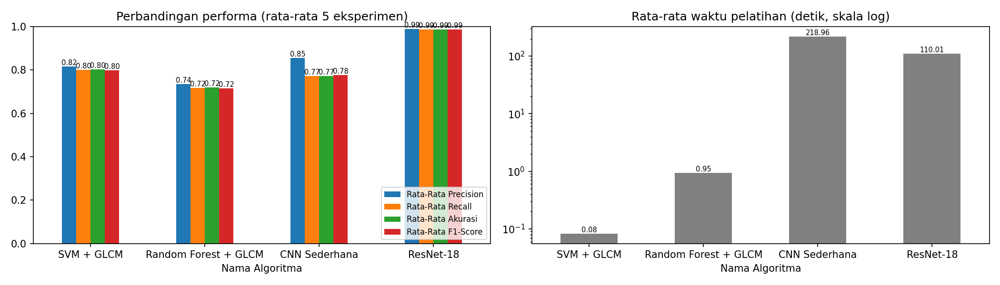

# Klasifikasi Citra Tulisan Tangan — Dataset MLE

Tugas mata kuliah Machine Learning: identifikasi penulis dari citra tulisan tangan (44 penulis, 2.311 citra) menggunakan ekstraksi fitur GLCM + classifier klasik dan dua arsitektur deep learning.

## Metode

| Metode | Input | Keterangan |
|---|---|---|
| SVM (RBF) + GLCM | 112 fitur GLCM | StandardScaler, C = 10 |
| Random Forest + GLCM | 112 fitur GLCM | 300 pohon |
| CNN Sederhana | citra 128 × 512 | 4 blok konvolusi, dilatih dari nol, 30 epoch |
| ResNet-18 | citra 128 × 512 | transfer learning ImageNet, 25 epoch |

- **Preprocessing:** grayscale → crop area tinta (Otsu) → resize 128 × 512.
- **GLCM:** 32 level keabuan, jarak 1/2/3/5, sudut 0°/45°/90°/135°, 7 fitur (contrast, dissimilarity, homogeneity, energy, correlation, ASM, entropy).
- **Evaluasi:** Stratified 5-Fold Cross Validation (5 eksperimen), metrik Precision/Recall/F1 (macro) dan Akurasi.

## Hasil

| Metode | Precision | Recall | Akurasi | F1-Score | Waktu Pelatihan (s) |
|---|---|---|---|---|---|
| SVM + GLCM | 0.8153 | 0.7996 | 0.8018 | 0.7977 | 0.08 |
| Random Forest + GLCM | 0.7358 | 0.7179 | 0.7205 | 0.7160 | 0.95 |
| CNN Sederhana | 0.8547 | 0.7717 | 0.7733 | 0.7766 | 218.96 |
| **ResNet-18** | **0.9880** | **0.9868** | **0.9870** | **0.9868** | 110.01 |

Waktu ekstraksi fitur GLCM: 5,20 detik untuk 2.311 citra (2,25 ms/citra). SVM dan Random Forest dilatih di CPU; CNN dan ResNet-18 di GPU NVIDIA RTX 3050 Ti.



## Struktur

```
Klasifikasi_Citra_MLE.ipynb   notebook utama (kode + output)
hasil/                        tabel hasil per metode, rekap, dan grafik
data_raw/MLE/                 dataset (tidak disertakan di repo)
```

## Menjalankan

1. Letakkan dataset di `data_raw/MLE/`, satu sub-folder per kelas (penulis). Dataset tidak disertakan karena berisi data pribadi.
2. Pasang dependensi:
   ```bash
   pip install -r requirements.txt
   ```
   Untuk GPU NVIDIA, pasang PyTorch versi CUDA sesuai petunjuk di [pytorch.org](https://pytorch.org/get-started/locally/).
3. Jalankan seluruh sel di `Klasifikasi_Citra_MLE.ipynb`.

## Anggota Kelompok

| NIM | Nama | Tugas yang Dikerjakan |
|---|---|---|
| ... | ... | ... |
| ... | ... | ... |
